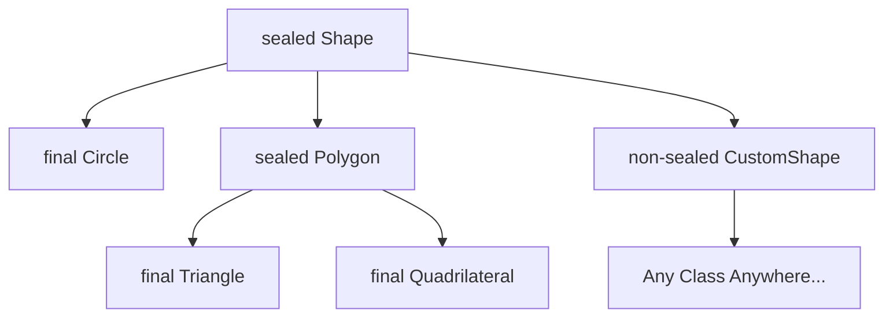

# Lesson 5.12: Sealed Classes

Prior to Java 15, Java offered only two extremes of inheritance:
1. **Unrestricted inheritance:** A `public` non-final class can be extended by any class, anywhere in the world.
2. **Total lockdown:** A `final` class cannot be extended by anyone at all.

There was no middle ground to say: *"I want class `Shape` to be extended, but **only** by `Circle`, `Square`, and `Rectangle` — and no other class in the universe."*

Java 15 introduced (and Java 17 finalized) **Sealed Classes and Interfaces**, giving developers fine-grained control over which classes can extend or implement them.

---

## 1. Why Sealed Classes? (Algebraic Data Types)

In domain-driven design, you frequently want to represent a **fixed set of possibilities** (known in type theory as a "sum type" or "closed hierarchy").

Examples:
- A `PaymentMethod` can only be `CreditCard`, `PayPal`, or `Crypto`.
- A `TrafficLight` can only be `Red`, `Yellow`, or `Green`.
- A `JSONValue` can only be `JSONObject`, `JSONArray`, `JSONString`, `JSONNumber`, `JSONBoolean`, or `JSONNull`.

Before sealed classes, developers attempted to restrict inheritance using `package-private` constructors:

```java
// Pre-Java 17 workaround: package-private constructor
public abstract class Shape {
    Shape() {} // Only classes in the same package can extend this
}
```

This was awkward, package-scoped, and invisible to the compiler and tooling. Sealed classes solve this natively.

---

## 2. Basic Syntax: `sealed` and `permits`

To seal a class or interface, use the `sealed` modifier and specify the allowed subclasses with `permits`:

```java
public sealed class Shape permits Circle, Rectangle, Triangle {
    // Common properties or methods
}

public final class Circle extends Shape {
    private final double radius;
    public Circle(double radius) { this.radius = radius; }
    public double radius() { return radius; }
}

public final class Rectangle extends Shape {
    private final double width, height;
    public Rectangle(double width, double height) {
        this.width = width;
        this.height = height;
    }
}

public final class Triangle extends Shape {
    private final double base, height;
    public Triangle(double base, double height) {
        this.base = base;
        this.height = height;
    }
}
```

If another class tries to extend `Shape`:

```java
// ❌ COMPILE ERROR: Class Hexagon is not allowed to extend sealed class Shape
public class Hexagon extends Shape {}
```

---

## 3. The Three Subclass Modifiers

Every permitted subclass **must explicitly choose** how it continues the inheritance hierarchy by using one of three modifiers:

1. **`final`**: The subclass cannot be extended any further (the hierarchy ends here).
2. **`sealed`**: The subclass is also sealed and must specify its own `permits` list.
3. **`non-sealed`**: The subclass breaks out of the sealed contract and allows open, unrestricted inheritance by anyone.



```java
// 1. final: End of the line
public final class Circle extends Shape {}

// 2. sealed: Sub-hierarchy with its own restrictions
public sealed class Polygon extends Shape permits Triangle, Pentagon {}

// 3. non-sealed: Re-opens inheritance
public non-sealed class CustomShape extends Shape {}
```

---

## 4. Rules & Constraints

1. **Explicit permission:** All permitted subclasses must be declared in the `permits` clause (unless they are defined in the **same source file**, in which case `permits` can be omitted).
2. **Direct extension:** Every permitted subclass must *directly* extend the sealed class or implement the sealed interface.
3. **Co-location / Module boundary:**
   - In a **modular project (JPMS)**, the sealed class and its permitted subclasses must belong to the **same module**.
   - In a **non-modular project (classpath)**, they must belong to the **same package**.

---

## 5. Sealed Interfaces

Interfaces can also be sealed:

```java
public sealed interface OrderEvent permits OrderCreated, OrderShipped, OrderCancelled {}

public record OrderCreated(String orderId, double amount) implements OrderEvent {}
public record OrderShipped(String orderId, String trackingNumber) implements OrderEvent {}
public record OrderCancelled(String orderId, String reason) implements OrderEvent {}
```

> [!TIP]
> Notice how `OrderCreated`, `OrderShipped`, and `OrderCancelled` are **records**! Because records are implicitly `final`, you do not need to write `final record`. **Sealed Interfaces + Records** is one of the most powerful modern design patterns in Java.

---

## 6. The Killer Feature: Exhaustive Switch (Pattern Matching)

Because the compiler knows *every possible subclass* of a sealed type, it can verify **exhaustiveness** in a `switch` expression.

You **do not need a `default` branch** if all permitted types are covered:

```java
public static double calculateArea(Shape shape) {
    return switch (shape) {
        case Circle c    -> Math.PI * c.radius() * c.radius();
        case Rectangle r -> r.width() * r.height();
        case Triangle t  -> 0.5 * t.base() * t.height();
        // No default needed! The compiler knows these are the only 3 shapes.
    };
}
```

### What happens if you add a new subclass later?
If someone adds `Ellipse` to `permits Circle, Rectangle, Triangle, Ellipse`:
The compiler immediately flags **every single `switch` statement** across your entire project that processes `Shape` with a compile error:
`"the switch expression does not cover all possible input values"`!

This completely prevents runtime bugs caused by forgotten cases.

---

## 7. Real-World Architectural Pattern: The Result Type

Instead of throwing exceptions or returning `null`, modern functional Java uses a sealed `Result<T>`:

```java
public sealed interface Result<T> permits Result.Success, Result.Failure {

    record Success<T>(T value) implements Result<T> {}
    record Failure<T>(String errorMessage, Exception cause) implements Result<T> {}

    default boolean isSuccess() {
        return this instanceof Success<T>;
    }
}
```

Usage:
```java
Result<User> result = findUser("alice@example.com");

String output = switch (result) {
    case Result.Success<User> s -> "Found user: " + s.value().name();
    case Result.Failure<User> f -> "Failed to load user: " + f.errorMessage();
};
```

---

## 8. Summary Checklist

- Use `sealed` when you have a closed, bounded domain model.
- Each permitted subclass must be `final`, `sealed`, or `non-sealed`.
- Use **Sealed Interfaces + Records** for lightweight, immutable algebraic data types.
- Leverage **Exhaustive Pattern Matching `switch`** without needing a fallback `default` case.
